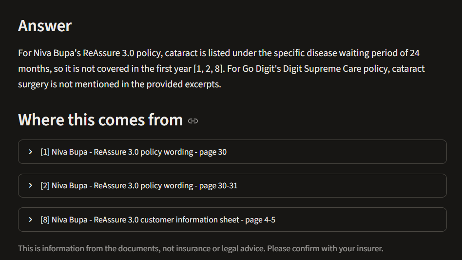
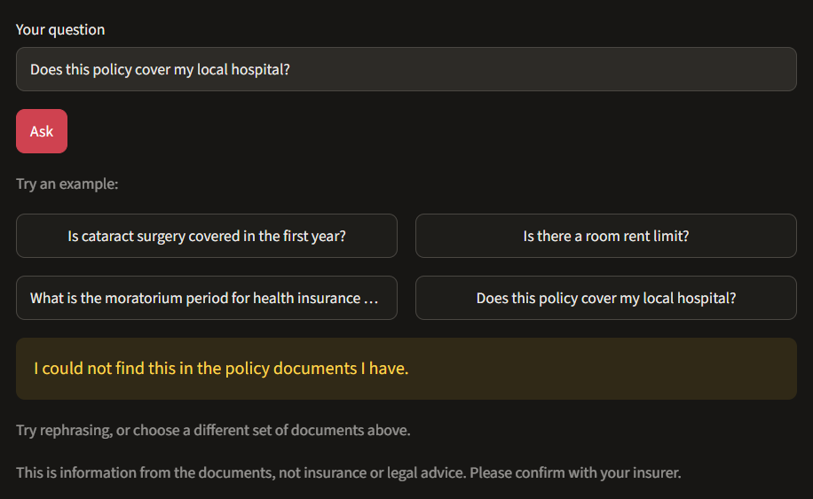
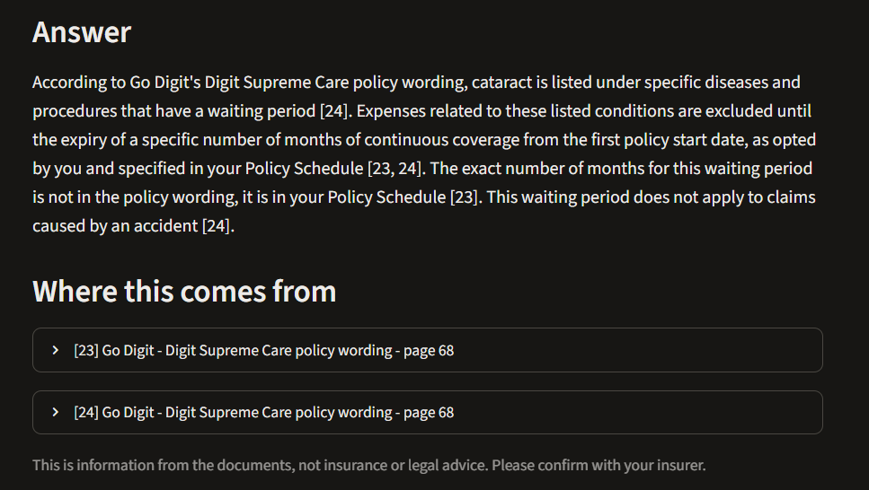

# Health Insurance Policy Assistant

**Live demo:** https://health-insurance-policy-assistant-f8bej3xvgcfmlbv5fkk2uk.streamlit.app/

Ask a plain-language question about a health insurance policy and get a short answer that shows **the PDF page it came from**. If the documents don't say, the app says so instead of guessing.

## The problem

Health insurance wording is long and hard to read. Most people only find out about waiting periods, exclusions and claim rules when a claim is rejected. This tool lets someone ask "Is cataract surgery covered in the first year?" and get an answer with a page number they can check.

## What it does

- Answers questions from two Indian policies and the regulator's rules.
- Cites the source page for every fact, with the original text shown on screen.
- Compares both insurers side by side when asked.
- Says "I could not find this in the policy documents I have" when the documents have no answer.
- Tells you when a number lives in your own Policy Schedule (which it cannot see).

## Screenshots

| Cited answer | Honest refusal | Partial answer |
|---|---|---|
|  |  |  |

## Documents used

| Document | Source |
|---|---|
| Niva Bupa ReAssure 3.0 policy wording (UIN NBHHLIP27059V022627) and customer information sheet | Niva Bupa website |
| Go Digit Digit Supreme Care policy wording and customer information sheet | Go Digit website |
| IRDAI Master Circular on Health Insurance Business (29 May 2024) | IRDAI website |

## How it works

1. **Read:** PyMuPDF extracts text from each PDF page, keeping the page number.
2. **Chunk:** text is split into chunks of about 220 words (495 chunks), each tagged with insurer, document and pages.
3. **Index:** chunks are turned into embeddings and stored in ChromaDB.
4. **Retrieve:** the question is matched to the closest chunks. Each hit also pulls in its neighbouring chunks, because answers often cross a chunk boundary. When comparing, the search runs separately for each insurer so one cannot crowd out the other.
5. **Answer:** Gemini (via `google-genai`) writes the answer using only those excerpts, cites them as [1], [2], and must refuse when they contain nothing relevant. Temperature is 0.1, and the code falls back to other Gemini models if one is busy.
6. **Show:** a Streamlit page displays the answer and only the sources it actually cited.

## Results

I wrote 30 test questions from the PDFs (answerable, comparison, and should-refuse) and checked each answer against the PDF pages.

| | Baseline | Final |
|---|---|---|
| Correct answers | 25/30 (83%) | **26/30 (87%)** |
| Right page retrieved | 18/21 (86%) | 19/21 (90%) |
| Refused when it should, answered when it should | 28/30 (93%) | 30/30 (100%) |
| Average time per question | 3.7 s | 2.8 s |

Improvements between the two: a looser refusal rule (answer the part the documents cover, say what is missing), neighbour-chunk retrieval, and per-insurer search for comparisons.

Note: refusal accuracy is not the same as correctness. An app can answer when it should and still answer wrongly.

## Known limitations

- **It cannot see your Policy Schedule.** Plan-specific numbers (room rent limit, some waiting periods) are not in the public wording.
- **Some answers are still wrong.** In testing, one question missed the right page (44) and the app gave a confident wrong answer. Another omitted Digit's initial waiting period.
- **Tables are weak.** Two questions got worse after adding more context, one because the answer sits in a table.
- **Small test set.** 30 questions is a sanity check, not a benchmark.
- **Two insurers only,** no premiums, and documents are the versions listed above.
- **Free-tier AI service** can be slow or busy; the app shows a retry message when that happens.
- Not insurance or legal advice. Always confirm with your insurer.

## Run it yourself

```bash
git clone https://github.com/akanshadhi/health-insurance-policy-assistant.git
cd health-insurance-policy-assistant
pip install -r requirements.txt
```

Create a file called `.env` containing `GEMINI_API_KEY=your_key_here`, then:

```bash
streamlit run app.py
```

The search index is rebuilt automatically from `data/chunks.jsonl` on first start. To rebuild from the PDFs, put them in `data/raw/` and run `python ingest.py` then `python build_index.py`. To rerun the evaluation: `python run_eval.py baseline`.

## Next steps

- Add more insurers and newer policy versions.
- Better handling of tables.
- Re-rank retrieved chunks before answering.
- Ask for the user's Policy Schedule details to answer plan-specific questions.

## Tech

Python, PyMuPDF, ChromaDB, Google Gemini API, Streamlit.
